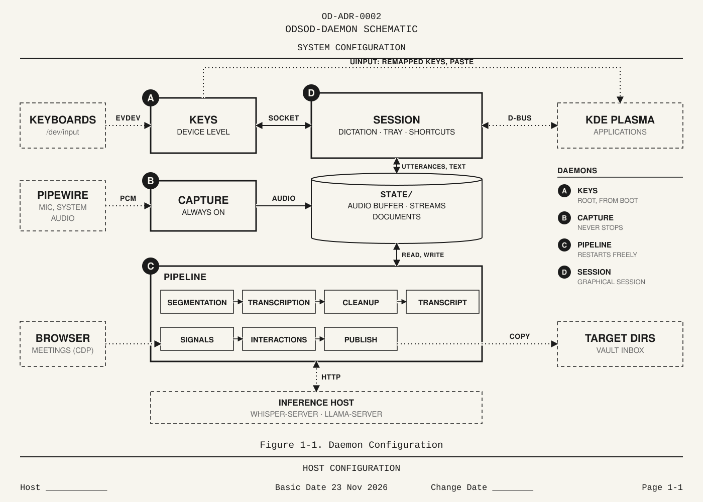

# daemon

My personal daemon: one system of long-running services on my hosts that
handle input, audio and text. Built for one setup: Fedora, KDE Plasma on
Wayland, PipeWire and systemd.



All speech and language models run on my own hosts, over the tailnet. The
owner uses one CLI, `odsodctl`.

## Docs

- What the owner sees and does: [`docs/prd/`](docs/prd/).
- How it is built: [`docs/adr/`](docs/adr/). The subsystems and their
  ADRs are in [ADR-0009](docs/adr/0009-taxonomy-and-code-organization.md),
  and the seams between them in
  [ADR-0010](docs/adr/0010-contracts-and-runtime.md).
- The detailed diagram:
  [`high-level-architecture.svg`](docs/diagrams/high-level-architecture.svg).
- The order of work: [`docs/plans/`](docs/plans/README.md).
- The research behind the design:
  [`docs/research/`](docs/research/alternatives.md).

## Status

- The Python daemon replaces the Go recorder. It runs capture, pipeline and
  tray as systemd user services.
- The Go recorder is gone from the tree. Its last version is in the history
  before this change.
- Dictation and keys wait for the keyboard cutover, see
  [`docs/plans/`](docs/plans/README.md).

## Development

```sh
mise run build    # the CI gate
mise run deploy   # install the working copy as the live dev system
odsodctl status   # running state and health
```
