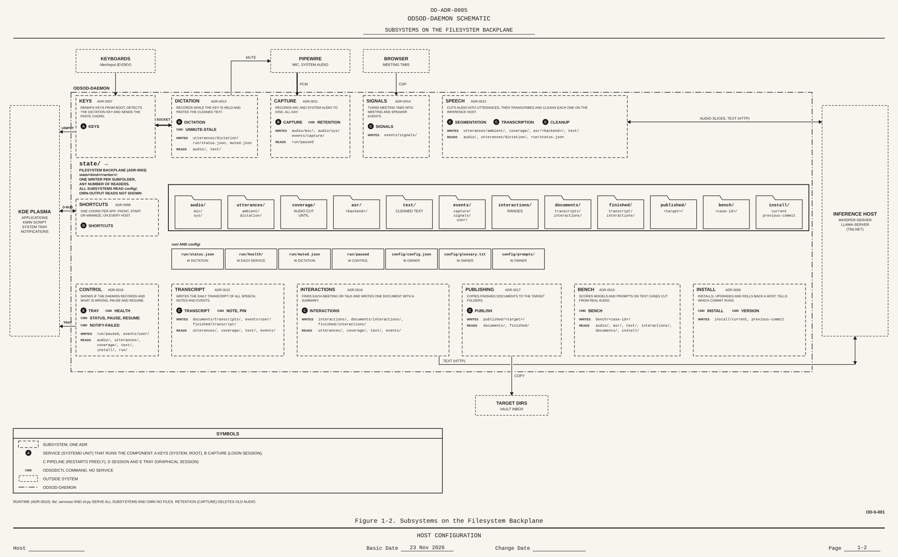

# ADR-0005: Components and implementation

## Status

Proposed

## Date

2026-11-23

## Context

- [ADR-0002](0002-high-level-architecture.md) sets the capabilities and
  principles. [ADR-0003](0003-filesystem-interface.md) defines the files,
  [ADR-0004](0004-orchestration-with-systemd.md) the services and
  [ADR-0007](0007-keys-service.md) the keys service.
- Agents need to know exactly which components exist, what each one does, and
  how to build it: language, libraries, tools and code layout.
- The best speech and audio tools (Silero VAD, language ID, ASR toolkits,
  WER, and later pyannote) are Python libraries.
- A source study of nine dictation and meeting tools
  ([alternatives.md](../research/alternatives.md)) gave the evidence for the
  rules below. Each rule names its source.
- The `machine` repo turns off WirePlumber's switch to the Bluetooth headset
  profile. A headset offers only its stereo sink and no mic, so capture never
  forces a headset into low-quality call mode.
- This ADR is longer than one page, because it covers every component. Each
  component ADR can supersede its section.

## Decision

### Language and tooling

- **Python 3.14** for all code except the keys service, pinned in
  `.python-version`. Move to the next Python version when every runtime
  dependency ships wheels for it. (Python 3.15 is out, but onnxruntime has no
  3.15 wheels yet.)
- **C** for the keys service (ADR-0007), built with `gcc -Wall -Wextra -Werror`.
- **uv** manages Python, dependencies (`uv.lock`) and installs. uv comes from
  mise.
- **ruff** for lint and format. **pyright** in strict mode for types.
  **pytest** for tests. **import-linter** enforces the module boundaries
  ([ADR-0009](0009-taxonomy-and-code-organization.md)).
- `mise run build` runs all of them and compiles the keys service. It is the CI
  gate.

### Libraries

| Need                                | Library                                       |
| ----------------------------------- | --------------------------------------------- |
| CLI                                 | `typer`                                       |
| Config and stream records           | `pydantic` v2                                 |
| Concurrency                         | `asyncio` with `TaskGroup`                    |
| HTTP (whisper-server, llama-server) | `httpx` (async)                               |
| Chrome DevTools Protocol            | `websockets`                                  |
| File watching                       | `watchfiles`                                  |
| Audio arrays                        | `numpy`                                       |
| VAD                                 | Silero VAD model (ONNX) on `onnxruntime`, CPU |
| Tray icon                           | `PySide6` (`QSystemTrayIcon`, plain Qt loop)  |
| D-Bus (KWin, KGlobalAccel)          | `dbus-fast` (asyncio)                         |
| Prompt templates                    | `jinja2`                                      |
| Benchmark (optional extra `bench`)  | `jiwer`                                       |
| Logging                             | stdlib `logging` to stdout (journald)         |

- The `silero-vad` package requires torch and CUDA libraries, about 3 GB
  ([YazSes](../research/yazses.md)). The system ships the Silero ONNX model
  file and runs it on `onnxruntime` directly.
- No torch in version 1. Diarization, which needs it, is deferred (see
  "Later").
- The keys service uses only libc and Linux headers.
- A new runtime dependency needs an ADR.

### Code layout

- [ADR-0009](0009-taxonomy-and-code-organization.md) defines the terms, the
  folders, the dependency rules and the tests.
- `lib/health` merges unit states from systemd with the fault files
  `run/health/<service>.json` ([ADR-0003](0003-filesystem-interface.md)),
  audio freshness and backlog. `tray` and `status` use it, so they always
  agree.
- Each service writes its own faults, with their `since` time, to its health
  file: capture (digital zeros, stall), pipeline (no inference host, missing
  target, no speaking indicator), session (mute failed, no keys socket).
- A component can add read-only `odsodctl` subcommands from its own folder,
  such as `odsodctl transcript`, `odsodctl shortcuts` and
  `odsodctl dictation last`. They read files only and never talk to the
  running service.
- `odsodctl run <service>` starts a service (`capture`, `pipeline`,
  `session`, `tray`). The units use it.
  `odsodctl run <component>` runs one component alone. The keys service is
  its own binary, `odsod-daemon-keys`.

### Components

Diagram source: [`high-level-architecture.py`](../diagrams/high-level-architecture.py),
with the shared style in [`schematic.py`](../diagrams/schematic.py). The README
shows the overview, [`overview.py`](../diagrams/overview.py). Regenerate with
`uv run docs/diagrams/<name>.py docs/diagrams/<name>.svg`.

Components fall into four domains. Services group them by lifecycle
(ADR-0002 principle 13); domains group them by what they are about. Each
component owns one job or one output.

| Domain    | Component                              | Responsibility                                                        | Service or command | Main tools                          |
| --------- | -------------------------------------- | --------------------------------------------------------------------- | ------------------ | ----------------------------------- |
| Input     | keys                                   | Device level: remap keys; dictation key; paste keys                   | keys               | `evdev` and `uinput` ioctls (C)     |
| Input     | shortcuts                              | Compositor level: register global shortcuts; launch apps for KWin     | session            | `dbus-fast`, `systemd-run`          |
| Speech    | capture                                | Record mic and system audio to the audio buffer                       | capture            | `pw-record`                         |
| Speech    | segmentation                           | Cut ambient audio into utterances                                     | pipeline           | Silero VAD                          |
| Speech    | transcription                          | Turn utterances into text; one worker per ASR backend                 | pipeline           | whisper-server, Silero VAD          |
| Speech    | cleanup                                | Fix ASR text with an LLM and the glossary                             | pipeline           | llama-server                        |
| Speech    | dictation                              | The dictation loop: meeting mute, utterance, clipboard                | session            | keys socket, `pactl`, `wl-copy`     |
| Documents | signals                                | Meeting and speaker events from the browser                           | pipeline           | Chrome DevTools Protocol            |
| Documents | transcript                             | Sole writer of the daily transcript (live pass)                       | pipeline           |                                     |
| Documents | interactions                           | Sole writer of interactions: boundaries, then documents (batch pass)  | pipeline           | llama-server                        |
| Documents | publish                                | Copy finished documents to configured targets                         | pipeline           |                                     |
| Control   | tray                                   | Tray icon: mode and health; pause and resume                          | tray               | PySide6, `systemctl`                |
| Control   | note, pin, status, pause, resume       | Owner events; health view; pause and resume recording                 | command            | `systemctl`                         |
| Control   | retention, unmute-stale, notify-failed | Delete expired audio; unmute streams left muted; notify a failed unit | command            | `pactl`, `notify-send`              |
| Control   | install                                | Write and enable the units; build keys; install the KWin script       | command            | `systemctl`, `gcc`, `kpackagetool6` |
| Control   | bench                                  | Score setups against accepted references                              | command            | jiwer                               |
| Control   | version                                | Print the installed commit                                            | command            |                                     |

- `dictation` sits on the edge of Input and Speech. It belongs to Speech: it
  produces utterances, and uses the keys service only as trigger and paste.

### keys

- Defined in [ADR-0007](0007-keys-service.md).

### shortcuts

- Defined in [ADR-0008](0008-shortcuts-and-kwin-script.md).

### capture

- Runs one `pw-record --raw --rate 16000 --channels 1 --format s16` per
  channel as an asyncio subprocess. PipeWire resamples and mixes down.
- `mic` follows the default source, so recording captures the mic the owner
  uses. A plugged-in mic, or a new choice in KDE, takes effect with no
  restart. When the mic in use disappears, PipeWire moves the stream to the
  next source. A Bluetooth headset offers no mic (see Context), so this never
  switches a headset to call mode.
- `sys` follows the default sink's monitor.
- Sets its own stream properties (application name `odsod-daemon-capture`),
  so dictation never mutes capture.
- Uses the default PipeWire latency and no media role. A small fragment can
  shrink the graph quantum and glitch a live call
  ([Meetily](../research/meetily.md)). Role `Communication` made Bluetooth
  capture record silence ([OpenWhispr](../research/openwhispr.md)).
- Writes 100 ms blocks at the offset given by wall-clock start plus sample
  count. Pings the watchdog on each block.
- Re-anchors to the wall clock: on each block it compares the expected
  offset with the wall clock. Above 200 ms ahead, it seeks forward and leaves
  a gap. Behind, it drops samples until the two agree. It never writes
  backward. This keeps key timestamps and audio aligned through sound card
  drift and clock steps.
- Restarts `pw-record` after a resume from suspend.
- Writes start, stop and gap records to `state/events/capture/`, so
  `transcript` can name the cause of each gap.
- Does not start while `run/paused` exists (ADR-0004).
- Flags a channel that delivers only digital zeros for a configured time in
  its health file ([Handy](../research/handy.md)). This is a Warning, not an
  Error: a hardware mic switch gives the same zeros with no PipeWire mute
  flag.
- **Echo:** without a headset, `mic` hears the meeting. Text dedup is the
  baseline (see `transcript` and `interactions`). A PipeWire
  `module-echo-cancel` source in monitor mode
  ([Voxtype](../research/voxtype.md)) is a bench experiment: config adds it
  as the extra channel `mic-ec`, never as the default source. A later ADR
  adopts it if bench data shows a gain. Echo cancellation is lossy when both
  sides talk, so raw `mic` is always kept.

### segmentation

- Runs Silero VAD on new audio per channel. Cuts utterances at pauses, with a
  minimum and maximum length. A forced cut goes at the lowest speech
  probability in the second half of the utterance, not at the exact limit
  ([WhisperX](../research/whisperx.md)).
- VAD settings (threshold, minimum pause, padding) are config values per
  channel. Bench data tunes them.
- Drops `mic` speech inside a dictation window. It reads
  `state/utterances/dictation/` and writes no ambient `mic` utterance that
  overlaps one. A dictation then gives one line, and its words never reach a
  meeting summary. A `mic` utterance waits until segmentation knows that no
  dictation is open over it.
- Knows nothing about meetings or interactions. It turns audio into
  utterances and nothing else.

### transcription

- One worker per configured backend. Takes pending dictation first, then
  ambient, oldest first.
- Cuts the audio slice, wraps it as WAV in memory and posts it to
  whisper-server.
- Inference URLs must point to `localhost` or a tailnet address. A client
  refuses any other host, so audio never crosses a network in the clear. The
  servers listen on the tailnet only.
- On battery, the workers use only remote inference hosts. There is no local
  ASR fallback. With no inference host reachable, ambient work waits in files
  and the pipeline health file shows "no inference host".
- An external fault (timeout, unreachable host) gets bounded retries with
  backoff. A rejected request, or a slice whose audio has expired, gets a
  `failed` or `expired` record ([ADR-0003](0003-filesystem-interface.md)).
- Puts the glossary in the Whisper prompt, most important terms last. Whisper
  keeps only the tail of a long prompt.
- No conditioning on previous text. One utterance per request already gives
  this.
- **Dictation is not ambient.** A dictation utterance is the owner's whole key
  hold:
  - No VAD cuts inside it. Cut pauses make Whisper decode near-silence and
    recite the glossary ([OpenWhispr](../research/openwhispr.md)).
  - A Silero presence gate instead: no speech means empty text, with no
    request ([YazSes](../research/yazses.md)).
  - Stricter decoder thresholds against hallucinated tails, for dictation
    only. Bench data confirms the values.
- **Dictation is English.** Dictation requests fix the language to English
  (owner decision). The code-switching strategy applies to ambient audio
  only. It is a config choice, and bench data picks the default.

### cleanup

- Sends raw text with the glossary prompt to llama-server. Same order as
  transcription: dictation first.
- Dictation cleanup has a 1 s time limit. On timeout, cleanup writes the raw
  ASR text, so a paste never waits for a busy server.
- The inference host runs llama-server with two parallel slots. A long batch
  summary from any host then holds only one slot, and dictation cleanup gets
  the other. The `machine` repo owns this setting.
- The prompt wraps the text in tags, states that the speaker never talks to
  the model, and forbids answers to questions in the text. Cleanup strips
  reasoning blocks from the reply ([OpenWhispr](../research/openwhispr.md),
  [Handy](../research/handy.md)).
- Writes empty text for silence hallucinations: text that recites the
  glossary, or a known phantom phrase. Empty text still marks the ID as done.
- Guards the reply: if its length is far from the input length, or it drops
  numbers or names, cleanup writes the raw text instead
  ([YazSes](../research/yazses.md)).

### dictation

- One control loop, kept in memory, because its steps depend on each other's
  timing. Modules: `mute`, `delivery`.
- Connects to the keys socket and gets `start`, `stop` and `cancel` with key
  timestamps.
- Connects only while dictation can work: capture is active, recording is not
  paused, and an inference host is reachable. Otherwise it disconnects, so
  Left Alt is a plain Alt (ADR-0007), and health shows why: Paused, or the
  Warning "no inference host".
- `mute`, on `start`: mutes every capture stream on the mic in use except
  capture's own, with `pactl`. From then on the meeting app hears nothing,
  and `capture` still records the owner. The meeting can hear the owner
  before the hold threshold; this is accepted (owner decision, 2026-11-23).
  - Mutes only streams that were not muted already, and records them in
    `run/muted.json` before it mutes.
  - On `stop` or `cancel`: unmutes only those streams. A stream that ended
    meanwhile is not an error.
  - After a stop or crash: the session unit runs `odsodctl unmute-stale`
    (`ExecStopPost=`). It unmutes every stream left in `run/muted.json`. It
    imports no Qt and no dictation code, so it runs also when the service
    crash-loops.
  - Fails open: if muting fails, dictation goes on and the tray warns.
  - Source: the stream-level mute design of
    [Vibe Typer](../research/vibetyper.md), applied to capture streams
    instead of playback.
- On `stop`: waits until the `mic` audio file covers the `stop` time, then
  appends a dictation utterance (from the `start` timestamp minus pre-roll to
  the `stop` timestamp) and waits for its text in `state/text/`, for at most
  10 s.
- No text in 10 s: dictation gives up and sends a desktop notification. Text
  that arrives later is never pasted and never touches the clipboard.
  `odsodctl dictation last` prints the newest dictation text from
  `state/text/`, late or not.
- `delivery` pastes the text
  ([OpenWhispr](../research/openwhispr.md), [Handy](../research/handy.md)):
  - Saves the current clipboard.
  - Writes the text to CLIPBOARD and PRIMARY with
    `wl-copy --sensitive --type 'text/plain;charset=utf-8'`, so the KDE
    clipboard history does not keep it.
  - Sends `paste` to the keys socket. The keys service sends `Shift+Insert`,
    which pastes in GUI apps and terminals, on every layout.
  - After `pasted` and about 500 ms, restores the old clipboard, but only if
    the clipboard still holds the dictated text.
  - On `paste-failed`: leaves the text on the clipboard and sends a desktop
    notification, so the owner can paste by hand.
- Writes its mode (idle, dictating) to `run/status.json`.

### signals

- Polls meeting tabs over the Chrome DevTools Protocol, detects the platform,
  meeting changes, participants and the speaking indicator. Writes events.
  Ports the detection of the Go recorder.
- Meet first. Teams follows once Meet names pass bench.
- Speaker names are best effort. Missing names never block a document.
- Writes the Warning "meeting tab seen, no speaking indicator for 5 min" to
  the pipeline health file, so a meeting UI change does not fail in silence.
- Reads Chrome's debug port on `localhost` only. The `machine` repo owns the
  Chrome launch setup (profile directory and port).

### transcript

- Merges cleaned text and events (notes, pins, meetings) into the daily
  transcript. Lines carry their own timestamps.
- Appends in arrival order. A dictation line can come before an older ambient
  line.
- Drops a `mic` line that repeats a `sys` line from the same time window
  (echo). The component ADR defines the match and how long to wait for the
  `sys` text.
- Writes a gap line for each recording gap longer than 1 min, with its range
  and cause: pause, restart, logout or unknown. It reads the causes from
  `state/events/capture/` and the pause intents in `state/events/user/`.
  Utterances never span a gap.
- Finishes a day's transcript when the day has ended and none of its
  utterances is pending, or 48 h after the day ended. At that cap it writes
  an `untranscribed: <range>` gap line for each utterance still pending
  ([ADR-0003](0003-filesystem-interface.md)).
- `odsodctl transcript` prints today's transcript of this host. `--json`
  prints its lines as JSON.

### interactions

- Owns the whole life of an interaction: it detects the end, then runs the
  batch pass and writes the document.
- **Boundaries.** Reads utterance times and events, never audio. Writes an
  interaction when silence passes the configured cutoff, the meeting changes
  or the owner pins. Silence is the gap between utterances on all channels.
- Writes one record per finished interaction to `state/interactions/`: `ok`
  with the document name, or `skipped` for greetings and noise. A skipped
  interaction is done and is never tried again.
- The silence cutoff is a config value, default 5 minutes. In a meeting that
  stays open for hours, it is the main way to split the meeting into
  interactions, so the owner tunes it.
- **Meeting profiles** set the silence cutoff per meeting, and nothing else.
  Config maps a meeting code (for Meet, such as `abc-defg-hij`) to a cutoff.
  Example: a permanent pair-coding room gets a short cutoff, so each topic
  becomes its own interaction. With no match, the default applies. Pins
  cover the exceptions.
- **Batch pass.** For each finished interaction, reads the pass 1 cleaned
  text from `state/text/`. Dictation text is never part of an interaction.
- Speakers: a `mic` line is the owner. A `sys` line gets the meeting speaker
  with the largest overlap in the speaking-indicator timeline, as the Go
  recorder does. With no meeting or no indicator, other voices are
  "Others".
- Removes echo with full context: `mic` text that repeats `sys` text.
- Then cleans up with full context and summarizes (map-reduce for long
  interactions). No chapters in version 1.
- Pass 1 text is reused, not transcribed again. Bench data decides if a
  second ASR pass is worth the GPU time.
- Runs only on mains power: a power supply of type `Mains` reports
  `online`. A host with no `Mains` supply (the desktop) counts as on mains.
  Peripheral batteries, such as a pen, do not count. On battery,
  interactions stay pending in files and run once the host is plugged in.

### publish

- Copies finished documents to targets and records each delivery.
- The rename into the target is the commit point; the delivery record comes
  right after. A crash between them can deliver one copy twice. This is
  accepted ([ADR-0003](0003-filesystem-interface.md)).
- A missing or full target is a Warning in the pipeline health file.

### tray

- Runs in its own unit, `odsod-daemon-tray.service` (owner decision,
  2026-11-23). A Qt stall or crash then never delays a mute or a paste.
- Shows the tray icon with PySide6 on the plain Qt event loop. No asyncio, no
  `QtAsyncio`.
- Reads the mode from `run/status.json` and health from the `health` module,
  on a timer of about 1 s.
- Shows a separate dev mark while a dev install runs. It is not a Warning
  ([ADR-0006](0006-installation.md)).
- Pause and resume run `odsodctl pause` and `odsodctl resume`.
- No overlay window. A normal window steals focus on Wayland and catches the
  pasted text ([YazSes](../research/yazses.md)).

### note, pin, status, pause, resume, retention, unmute-stale, notify-failed, install, version

- `note` and `pin` append one line to `events/user/`.
- `status` uses `lib/health`. It also shows `dev: true` while a dev install
  runs.
- `pause` writes `run/paused`, appends a pause intent to `events/user/` and
  stops capture. `resume` removes `run/paused` and starts capture
  ([ADR-0004](0004-orchestration-with-systemd.md)).
- `retention` deletes audio older than the retention period. A timer runs it
  each hour and at login ([ADR-0003](0003-filesystem-interface.md)).
- `unmute-stale` unmutes the streams in `run/muted.json`. The session unit
  runs it after every stop.
- `notify-failed <unit>` sends a desktop notification that names a failed
  unit and its `systemctl` fix. `odsod-daemon-notify@.service` runs it from
  `OnFailure=` of every unit. It imports no Qt.
- `install` writes the user units and installs the KWin script (ADR-0008).
  `install --system` builds and installs the keys service (ADR-0004).
- `version` prints the installed commit, or `dev` with the workspace path
  and commit for a dev install (ADR-0006).

### bench

- A case is a directory with the audio slice, the ASR text, a draft
  reference and its source ([ADR-0003](0003-filesystem-interface.md)). An
  agent writes the draft. The owner listens with any player, edits the
  reference in any editor, and runs `odsodctl bench accept <case>`. No review
  UI.
- Runs a setup offline on all accepted cases. A setup is a model, a prompt
  or a setting. No live shadow backends in version 1: they would load the
  shared inference host during live use.
- Stores a setup manifest with each result: the model and its revision, a
  hash of the prompt, the settings and the daemon commit. Its fingerprint
  names the setup, so results from a changed setup never mix.
- Reports WER and latency first. Speaker and summary measures come later.
- Compares dictation backends on the owner's English dictations: Whisper on
  the inference host, a streaming model on the host's own CPU, and a cloud
  model through ambient Google Cloud credentials. Reports WER, time from
  release to text, local CPU load and cost. An ADR adopts a new dictation
  backend only on this data.
- Capture CPU and disk use, and key latency, are manual and system checks,
  not bench measures.

### Later

- **Diarization.** pyannote on the CPU, per host, as an optional extra. It
  names voices outside meetings ("Speaker 1", "Speaker 2") and splits
  overlapping speakers ([WhisperX](../research/whisperx.md)). Deferred from
  version 1 (owner decision, 2026-11-23): it brings torch, a Hugging Face
  token, a model download and hours of CPU on laptops. Adopt it per host when
  bench data shows the host can keep up.
- **Live shadow backends**, if offline bench runs are not enough.
- **Chapters** in long interaction documents, if overview and pins are not
  enough.

## Alternatives considered

### Go for always-on parts, Python for ML

- A single static binary and low memory, but two toolchains, file helpers in
  two languages, and half-measures in Go where Python has the real tool (an
  energy VAD instead of Silero).
- Rejected.

### Python 3.15

- Newest, but onnxruntime has no wheels for it yet.
- Rejected for now. Move when the wheels exist.

### `silero-vad` package

- Official, but requires torch in the always-on pipeline.
- Rejected: the ONNX model on `onnxruntime` does the same with far less
  memory.

### Second ASR pass in the batch pass

- Might fix pass 1 errors, but doubles GPU time on the shared host.
- Deferred until bench data shows it helps.

### Type the text instead of pasting it

- `ydotool type` scrambles non-US layouts such as Swedish, and a killed
  `ydotool type` leaves a key stuck ([VOXD](../research/voxd.md)). `wtype`
  does not work on KDE, which has no virtual keyboard protocol
  ([Handy](../research/handy.md)).
- Rejected: paste works on every layout and for all Unicode.

### Mute a virtual meeting mic

- The meeting app would use a virtual mic that dictation mutes.
- Rejected: the owner must route every meeting app to it, and something must
  create it. Muting the apps' capture streams needs no setup.

### Mix mic and system audio into one track

- Simpler capture, but loses "owner" versus "others" for free
  ([Meetily](../research/meetily.md)).
- Rejected.

### Fixed-time chunks without VAD

- Cuts mid-sentence ([hyprwhspr](../research/hyprwhspr.md)).
- Rejected.

### Interaction boundaries in segmentation

- Segmentation already sees the silence.
- Rejected: boundaries are meeting rules that the owner tunes, not signal
  processing. Utterance times give the same silence without audio.

### Echo cancellation as the only mic channel

- Removes echo before ASR, but distorts the owner's speech when both sides
  talk, and the raw audio is gone.
- Rejected: raw `mic` stays. `mic-ec` is an experiment beside it.

## Consequences

- Two toolchains, Python and C. The C part is one small service.
- Each always-on Python service uses on the order of 100 MB of memory.
- PySide6 is a large dependency, only for the tray icon. It runs in its own
  unit, so it never shares a process with dictation.
- No secrets, no Hugging Face token and no model download in version 1.
- Dictation needs the keys service and an inference host. Without them, Left
  Alt is a plain Alt, the tray shows why, and the rest of the system runs
  on.
- In version 1, documents name meeting speakers from the browser and call
  other voices "Others". Separate unnamed voices need diarization (Later).
- The meeting mute relies on how meeting apps react to a muted capture stream.
  Test it with Meet and Teams before dictation ships.
- The existing Go code is a reference for porting until the Python version
  replaces it.
